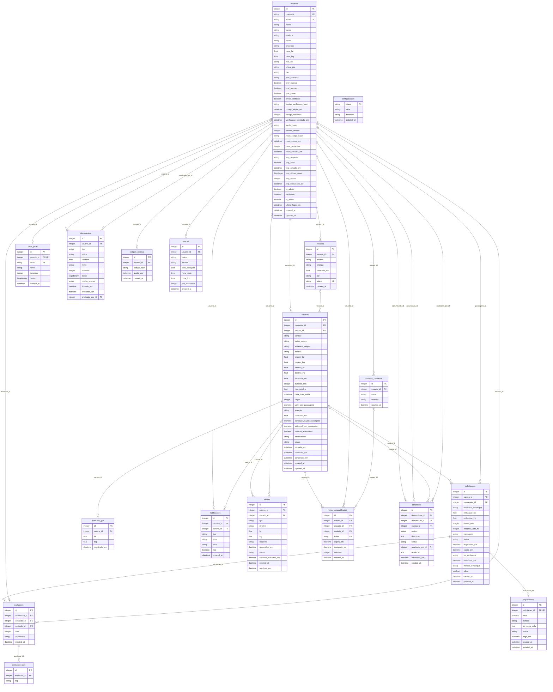

# CaronaUVV — Banco de dados

Modelo físico do banco do CaronaUVV: 18 tabelas, definidas em SQLAlchemy 2.0 (`backend/caronauvv/*/models.py`)
e versionadas com Flask-Migrate (`backend/migrations/`).

> O diagrama e o dicionário abaixo são gerados a partir do código (`db.metadata`), então refletem exatamente
> o que existe no banco.

## Onde fica e como criar

- **Desenvolvimento:** SQLite em `backend/instance/caronauvv.db` (fora do Git).
- **Produção:** PostgreSQL, definindo `DATABASE_URL`. Nada no código muda.

```bash
cd backend
flask --app app.py db upgrade     # cria/atualiza as tabelas pela migração
flask --app app.py seed-db        # configurações padrão + dados de exemplo (senha 123456)
flask --app app.py limpar-gps     # apaga trilhas GPS com mais de 30 dias
flask --app app.py db migrate -m "descricao"   # depois de alterar um models.py
```

Usuários de exemplo do seed: `admin@uvv.br` (admin), `kaua@uvv.br` e `lucas@uvv.br` (motoristas),
`ana@uvv.br` e `pedro@uvv.br` (passageiros), `beatriz@uvv.br` (com verificação em duas etapas).

## Tabelas por módulo

| Módulo | Tabelas | Prioridade |
|---|---|---|
| `auth` | `usuarios`, `veiculos`, `contatos_confianca`, `fotos_perfil`, `codigos_reserva` | núcleo / recomendada / extra / extra / extra |
| `caronas` | `caronas`, `solicitacoes`, `posicoes_gps` | núcleo / núcleo / extra |
| `avaliacoes` | `avaliacoes`, `avaliacao_tags`, `pagamentos` | recomendada / recomendada / extra |
| `notificacoes` | `notificacoes` | recomendada |
| `seguranca` | `alertas`, `links_compartilhados`, `denuncias` | extra |
| `admin` | `buscas`, `configuracoes` | extra |

## Regras garantidas pelo próprio banco

| Regra | Como |
|---|---|
| Passageiro não pede a mesma carona duas vezes | `UNIQUE (carona_id, passageiro_id)` em `solicitacoes` |
| Carona tem de 1 a 6 vagas e valor ≥ 0 | `CHECK` em `caronas` |
| Status só aceitam os valores previstos | `CHECK ... IN (...)` em caronas, solicitações, pagamentos, alertas e denúncias |
| Ninguém se avalia nem se denuncia | `CHECK avaliador_id <> avaliado_id`, `CHECK denunciante_id <> denunciado_id` |
| Nota de 1 a 5, uma avaliação por pessoa por viagem | `CHECK` + `UNIQUE (solicitacao_id, avaliador_id)` |
| Um pagamento por solicitação | `UNIQUE solicitacao_id` em `pagamentos` |
| Matrícula, e-mail, placa e token do link são únicos | `UNIQUE` |
| Chaves estrangeiras sempre válidas | `PRAGMA foreign_keys=ON` no SQLite (no PostgreSQL já é padrão) |
| Apagar carona apaga pedidos, GPS, alertas e links; apagar veículo deixa a carona sem veículo | `ON DELETE CASCADE` / `SET NULL` |
| Senha nunca em texto puro | hash Werkzeug em `usuarios.senha_hash` |
| Uma foto por aluno, com endereço único | `UNIQUE usuario_id` e `UNIQUE token` em `fotos_perfil` |
| Códigos de reserva e de recuperação nunca em texto | só o HMAC-SHA256 em `codigos_reserva.codigo_hash` e `usuarios.reset_codigo_hash` |
| Apagar o aluno apaga a foto e os códigos de reserva | `ON DELETE CASCADE` |

Regras que dependem de contexto (vagas restantes, carona no passado, telefone só após aceite,
expiração do pedido) ficam nos `services.py` e têm testes pytest.

## Diagrama físico



## Dicionário de dados

### `usuarios` (módulo `auth`)

| Coluna | Tipo | Nulo | Chave | Padrão |
|---|---|---|---|---|
| `id` | INTEGER | não | PK |  |
| `matricula` | STRING(20) | não | UNIQUE |  |
| `email` | STRING(255) | não | UNIQUE |  |
| `nome` | STRING(150) | não |  |  |
| `curso` | STRING(120) | sim |  |  |
| `telefone` | STRING(20) | não |  |  |
| `bairro` | STRING(100) | não | índice |  |
| `endereco` | STRING(255) | sim |  |  |
| `casa_lat` | FLOAT | sim |  |  |
| `casa_lng` | FLOAT | sim |  |  |
| `foto_url` | STRING(500) | sim |  |  |
| `chave_pix` | STRING(150) | sim |  |  |
| `bio` | STRING(300) | sim |  |  |
| `pref_conversa` | STRING(15) | não |  | `"depende"` |
| `pref_musica` | BOOLEAN | não |  | `True` |
| `pref_animais` | BOOLEAN | não |  | `False` |
| `pref_fumar` | BOOLEAN | não |  | `False` |
| `email_verificado` | BOOLEAN | não |  | `False` |
| `codigo_verificacao_hash` | STRING(255) | sim |  |  |
| `codigo_expira_em` | DATETIME | sim |  |  |
| `codigo_tentativas` | INTEGER | não |  | `0` |
| `verificacao_solicitada_em` | DATETIME | sim |  |  |
| `senha_hash` | STRING(255) | não |  |  |
| `sessao_versao` | INTEGER | não |  | `0` |
| `reset_codigo_hash` | STRING(255) | sim |  |  |
| `reset_expira_em` | DATETIME | sim |  |  |
| `reset_tentativas` | INTEGER | não |  | `0` |
| `reset_enviado_em` | DATETIME | sim |  |  |
| `totp_segredo` | STRING(64) | sim |  |  |
| `totp_ativo` | BOOLEAN | não |  | `False` |
| `totp_ativado_em` | DATETIME | sim |  |  |
| `totp_ultimo_passo` | BIGINTEGER | sim |  |  |
| `totp_falhas` | INTEGER | não |  | `0` |
| `totp_bloqueado_ate` | DATETIME | sim |  |  |
| `is_admin` | BOOLEAN | não |  | `False` |
| `verificado` | BOOLEAN | não |  | `False` |
| `is_active` | BOOLEAN | não |  | `True` |
| `ultimo_login_em` | DATETIME | sim |  |  |
| `created_at` | DATETIME | não |  | agora |
| `updated_at` | DATETIME | não |  | agora |

**Restrições:**

- CHECK `ck_usuarios_pref_conversa`: `pref_conversa IN ('quieto', 'depende', 'conversador')`

### `veiculos` (módulo `auth`)

| Coluna | Tipo | Nulo | Chave | Padrão |
|---|---|---|---|---|
| `id` | INTEGER | não | PK |  |
| `usuario_id` | INTEGER | não | FK → `usuarios.id`, ON DELETE CASCADE; índice |  |
| `modelo` | STRING(80) | não |  |  |
| `energia` | STRING(15) | não |  | `"flex"` |
| `consumo_km` | FLOAT | sim |  |  |
| `cor` | STRING(30) | não |  |  |
| `placa` | STRING(10) | não | UNIQUE |  |
| `created_at` | DATETIME | não |  | agora |

**Restrições:**

- CHECK `ck_veiculos_consumo`: `consumo_km IS NULL OR (consumo_km > 0 AND consumo_km <= 60)`
- CHECK `ck_veiculos_energia`: `energia IN ('gasolina', 'etanol', 'flex', 'diesel', 'hibrido', 'eletrico')`

### `contatos_confianca` (módulo `auth`)

| Coluna | Tipo | Nulo | Chave | Padrão |
|---|---|---|---|---|
| `id` | INTEGER | não | PK |  |
| `usuario_id` | INTEGER | não | FK → `usuarios.id`, ON DELETE CASCADE; índice |  |
| `nome` | STRING(100) | não |  |  |
| `telefone` | STRING(20) | não |  |  |
| `created_at` | DATETIME | não |  | agora |

### `fotos_perfil` (módulo `auth`)

| Coluna | Tipo | Nulo | Chave | Padrão |
|---|---|---|---|---|
| `id` | INTEGER | não | PK |  |
| `usuario_id` | INTEGER | não | FK → `usuarios.id`, ON DELETE CASCADE; UNIQUE |  |
| `token` | STRING(32) | não | UNIQUE |  |
| `mime` | STRING(20) | não |  |  |
| `tamanho` | INTEGER | não |  |  |
| `dados` | LARGEBINARY | não |  |  |
| `created_at` | DATETIME | não |  | agora |

### `documentos` (módulo `auth`)

| Coluna | Tipo | Nulo | Chave | Padrão |
|---|---|---|---|---|
| `id` | INTEGER | não | PK |  |
| `usuario_id` | INTEGER | não | FK → `usuarios.id`, ON DELETE CASCADE; índice |  |
| `tipo` | STRING(20) | não |  |  |
| `status` | STRING(20) | não | índice | `"pendente"` |
| `validade` | DATE | sim |  |  |
| `mime` | STRING(20) | sim |  |  |
| `tamanho` | INTEGER | sim |  |  |
| `dados` | LARGEBINARY | sim |  |  |
| `motivo_recusa` | STRING(255) | sim |  |  |
| `enviado_em` | DATETIME | não |  | agora |
| `analisado_em` | DATETIME | sim |  |  |
| `analisado_por_id` | INTEGER | sim | FK → `usuarios.id`, ON DELETE SET NULL |  |

**Restrições:**

- CHECK `ck_documentos_status`: `status IN ('pendente', 'aprovado', 'recusado')`
- CHECK `ck_documentos_tipo`: `tipo IN ('identidade', 'cnh')`
- UNIQUE `uq_documentos_usuario_tipo`: `usuario_id, tipo`

### `codigos_reserva` (módulo `auth`)

| Coluna | Tipo | Nulo | Chave | Padrão |
|---|---|---|---|---|
| `id` | INTEGER | não | PK |  |
| `usuario_id` | INTEGER | não | FK → `usuarios.id`, ON DELETE CASCADE; índice |  |
| `codigo_hash` | STRING(64) | não |  |  |
| `usado_em` | DATETIME | sim |  |  |
| `created_at` | DATETIME | não |  | agora |

### `caronas` (módulo `caronas`)

| Coluna | Tipo | Nulo | Chave | Padrão |
|---|---|---|---|---|
| `id` | INTEGER | não | PK |  |
| `motorista_id` | INTEGER | não | FK → `usuarios.id`; índice |  |
| `veiculo_id` | INTEGER | sim | FK → `veiculos.id`, ON DELETE SET NULL |  |
| `sentido` | STRING(10) | não |  | `"ida"` |
| `bairro_origem` | STRING(100) | não | índice |  |
| `endereco_origem` | STRING(255) | não |  |  |
| `destino` | STRING(255) | não |  | `"UVV - Entrada principal"` |
| `origem_lat` | FLOAT | sim |  |  |
| `origem_lng` | FLOAT | sim |  |  |
| `destino_lat` | FLOAT | sim |  |  |
| `destino_lng` | FLOAT | sim |  |  |
| `distancia_km` | FLOAT | sim |  |  |
| `duracao_min` | INTEGER | sim |  |  |
| `rota_polyline` | TEXT | sim |  |  |
| `data_hora_saida` | DATETIME | não | índice |  |
| `vagas` | INTEGER | não |  |  |
| `valor_por_passageiro` | NUMERIC(6,2) | não |  | `0` |
| `energia` | STRING(15) | sim |  |  |
| `consumo_km` | FLOAT | sim |  |  |
| `combustivel_por_passageiro` | NUMERIC(6,2) | sim |  |  |
| `adicional_por_passageiro` | NUMERIC(6,2) | sim |  |  |
| `reserva_automatica` | BOOLEAN | não |  | `False` |
| `observacoes` | STRING(300) | sim |  |  |
| `status` | STRING(20) | não | índice | `"ativa"` |
| `iniciada_em` | DATETIME | sim |  |  |
| `concluida_em` | DATETIME | sim |  |  |
| `cancelada_em` | DATETIME | sim |  |  |
| `created_at` | DATETIME | não |  | agora |
| `updated_at` | DATETIME | não |  | agora |

**Restrições:**

- CHECK `ck_caronas_adicional`: `adicional_por_passageiro IS NULL OR adicional_por_passageiro >= 0`
- CHECK `ck_caronas_sentido`: `sentido IN ('ida', 'volta')`
- CHECK `ck_caronas_status`: `status IN ('ativa', 'lotada', 'em_andamento', 'concluida', 'cancelada')`
- CHECK `ck_caronas_vagas`: `vagas BETWEEN 1 AND 6`
- CHECK `ck_caronas_valor`: `valor_por_passageiro >= 0`

### `solicitacoes` (módulo `caronas`)

| Coluna | Tipo | Nulo | Chave | Padrão |
|---|---|---|---|---|
| `id` | INTEGER | não | PK |  |
| `carona_id` | INTEGER | não | FK → `caronas.id`, ON DELETE CASCADE; índice |  |
| `passageiro_id` | INTEGER | não | FK → `usuarios.id`; índice |  |
| `endereco_embarque` | STRING(255) | sim |  |  |
| `embarque_lat` | FLOAT | sim |  |  |
| `embarque_lng` | FLOAT | sim |  |  |
| `desvio_min` | INTEGER | sim |  |  |
| `distancia_rota_m` | INTEGER | sim |  |  |
| `mensagem` | STRING(300) | sim |  |  |
| `status` | STRING(20) | não | índice | `"pendente"` |
| `respondida_em` | DATETIME | sim |  |  |
| `expira_em` | DATETIME | sim |  |  |
| `pin_embarque` | STRING(4) | sim |  |  |
| `embarcou_em` | DATETIME | sim |  |  |
| `metodo_embarque` | STRING(20) | sim |  |  |
| `faltou` | BOOLEAN | não |  | `False` |
| `created_at` | DATETIME | não |  | agora |
| `updated_at` | DATETIME | não |  | agora |

**Restrições:**

- CHECK `ck_solicitacoes_metodo_embarque`: `metodo_embarque IN ('pin', 'pin+gps', 'gps', 'manual')`
- CHECK `ck_solicitacoes_status`: `status IN ('pendente', 'aceita', 'recusada', 'cancelada', 'expirada')`
- UNIQUE `uq_solicitacao_carona_passageiro`: `carona_id, passageiro_id`

### `posicoes_gps` (módulo `caronas`)

| Coluna | Tipo | Nulo | Chave | Padrão |
|---|---|---|---|---|
| `id` | INTEGER | não | PK |  |
| `carona_id` | INTEGER | não | FK → `caronas.id`, ON DELETE CASCADE; índice |  |
| `lat` | FLOAT | não |  |  |
| `lng` | FLOAT | não |  |  |
| `registrada_em` | DATETIME | não | índice | agora |

### `avaliacoes` (módulo `avaliacoes`)

| Coluna | Tipo | Nulo | Chave | Padrão |
|---|---|---|---|---|
| `id` | INTEGER | não | PK |  |
| `solicitacao_id` | INTEGER | não | FK → `solicitacoes.id`, ON DELETE CASCADE; índice |  |
| `avaliador_id` | INTEGER | não | FK → `usuarios.id`; índice |  |
| `avaliado_id` | INTEGER | não | FK → `usuarios.id`; índice |  |
| `nota` | INTEGER | não |  |  |
| `comentario` | STRING(500) | sim |  |  |
| `created_at` | DATETIME | não |  | agora |

**Restrições:**

- CHECK `ck_avaliacoes_nao_autoavaliar`: `avaliador_id <> avaliado_id`
- CHECK `ck_avaliacoes_nota`: `nota BETWEEN 1 AND 5`
- UNIQUE `uq_avaliacao_solicitacao_avaliador`: `solicitacao_id, avaliador_id`

### `avaliacao_tags` (módulo `avaliacoes`)

| Coluna | Tipo | Nulo | Chave | Padrão |
|---|---|---|---|---|
| `id` | INTEGER | não | PK |  |
| `avaliacao_id` | INTEGER | não | FK → `avaliacoes.id`, ON DELETE CASCADE; índice |  |
| `tag` | STRING(40) | não |  |  |

**Restrições:**

- UNIQUE `uq_avaliacao_tag`: `avaliacao_id, tag`

### `pagamentos` (módulo `avaliacoes`)

| Coluna | Tipo | Nulo | Chave | Padrão |
|---|---|---|---|---|
| `id` | INTEGER | não | PK |  |
| `solicitacao_id` | INTEGER | não | FK → `solicitacoes.id`, ON DELETE CASCADE; UNIQUE |  |
| `valor` | NUMERIC(6,2) | não |  |  |
| `metodo` | STRING(20) | não |  | `"pix"` |
| `pix_copia_cola` | TEXT | sim |  |  |
| `status` | STRING(20) | não |  | `"pendente"` |
| `pago_em` | DATETIME | sim |  |  |
| `created_at` | DATETIME | não |  | agora |
| `updated_at` | DATETIME | não |  | agora |

**Restrições:**

- CHECK `ck_pagamentos_metodo`: `metodo IN ('pix', 'dinheiro')`
- CHECK `ck_pagamentos_status`: `status IN ('pendente', 'pago', 'cancelado')`
- CHECK `ck_pagamentos_valor`: `valor >= 0`

### `notificacoes` (módulo `notificacoes`)

| Coluna | Tipo | Nulo | Chave | Padrão |
|---|---|---|---|---|
| `id` | INTEGER | não | PK |  |
| `usuario_id` | INTEGER | não | FK → `usuarios.id`, ON DELETE CASCADE; índice |  |
| `carona_id` | INTEGER | sim | FK → `caronas.id`, ON DELETE SET NULL |  |
| `tipo` | STRING(40) | não |  |  |
| `titulo` | STRING(120) | não |  |  |
| `texto` | STRING(500) | não |  |  |
| `lida` | BOOLEAN | não |  | `False` |
| `created_at` | DATETIME | não | índice | agora |

**Restrições:**

- ÍNDICE `ix_notificacoes_usuario_lida`: `usuario_id, lida`

### `alertas` (módulo `seguranca`)

| Coluna | Tipo | Nulo | Chave | Padrão |
|---|---|---|---|---|
| `id` | INTEGER | não | PK |  |
| `carona_id` | INTEGER | não | FK → `caronas.id`, ON DELETE CASCADE; índice |  |
| `usuario_id` | INTEGER | sim | FK → `usuarios.id`, ON DELETE SET NULL |  |
| `tipo` | STRING(30) | não |  |  |
| `detalhe` | STRING(300) | sim |  |  |
| `lat` | FLOAT | sim |  |  |
| `lng` | FLOAT | sim |  |  |
| `resposta` | STRING(20) | sim |  |  |
| `respondido_em` | DATETIME | sim |  |  |
| `status` | STRING(20) | não | índice | `"aguardando"` |
| `contatos_avisados_em` | DATETIME | sim |  |  |
| `created_at` | DATETIME | não | índice | agora |
| `resolvido_em` | DATETIME | sim |  |  |

**Restrições:**

- CHECK `ck_alertas_resposta`: `resposta IN ('tudo_bem', 'preciso_ajuda', 'sem_resposta')`
- CHECK `ck_alertas_status`: `status IN ('aguardando', 'em_revisao', 'resolvido')`
- CHECK `ck_alertas_tipo`: `tipo IN ('parada_longa', 'sinal_perdido', 'desvio_rota', 'pin_sem_gps', 'botao_panico')`

### `links_compartilhados` (módulo `seguranca`)

| Coluna | Tipo | Nulo | Chave | Padrão |
|---|---|---|---|---|
| `id` | INTEGER | não | PK |  |
| `carona_id` | INTEGER | não | FK → `caronas.id`, ON DELETE CASCADE; índice |  |
| `usuario_id` | INTEGER | não | FK → `usuarios.id`, ON DELETE CASCADE |  |
| `contato_id` | INTEGER | sim | FK → `contatos_confianca.id`, ON DELETE SET NULL |  |
| `token` | STRING(64) | não | UNIQUE |  |
| `expira_em` | DATETIME | não |  |  |
| `revogado_em` | DATETIME | sim |  |  |
| `acessos` | INTEGER | não |  | `0` |
| `created_at` | DATETIME | não |  | agora |

### `denuncias` (módulo `seguranca`)

| Coluna | Tipo | Nulo | Chave | Padrão |
|---|---|---|---|---|
| `id` | INTEGER | não | PK |  |
| `denunciante_id` | INTEGER | não | FK → `usuarios.id`; índice |  |
| `denunciado_id` | INTEGER | não | FK → `usuarios.id`; índice |  |
| `carona_id` | INTEGER | sim | FK → `caronas.id`, ON DELETE SET NULL |  |
| `motivo` | STRING(60) | não |  |  |
| `descricao` | TEXT | sim |  |  |
| `status` | STRING(20) | não | índice | `"aberta"` |
| `analisada_por_id` | INTEGER | sim | FK → `usuarios.id`, ON DELETE SET NULL |  |
| `resolucao` | TEXT | sim |  |  |
| `encerrada_em` | DATETIME | sim |  |  |
| `created_at` | DATETIME | não |  | agora |

**Restrições:**

- CHECK `ck_denuncias_nao_autodenunciar`: `denunciante_id <> denunciado_id`
- CHECK `ck_denuncias_status`: `status IN ('aberta', 'em_analise', 'encerrada')`

### `buscas` (módulo `admin`)

| Coluna | Tipo | Nulo | Chave | Padrão |
|---|---|---|---|---|
| `id` | INTEGER | não | PK |  |
| `usuario_id` | INTEGER | sim | FK → `usuarios.id`, ON DELETE SET NULL; índice |  |
| `bairro` | STRING(100) | não | índice |  |
| `sentido` | STRING(10) | não |  | `"ida"` |
| `data_desejada` | DATE | não |  |  |
| `hora_inicio` | TIME | sim |  |  |
| `hora_fim` | TIME | sim |  |  |
| `qtd_resultados` | INTEGER | não |  | `0` |
| `created_at` | DATETIME | não | índice | agora |

**Restrições:**

- CHECK `ck_buscas_sentido`: `sentido IN ('ida', 'volta')`

### `configuracoes` (módulo `admin`)

| Coluna | Tipo | Nulo | Chave | Padrão |
|---|---|---|---|---|
| `chave` | STRING(60) | não | PK |  |
| `valor` | STRING(255) | não |  |  |
| `descricao` | STRING(255) | sim |  |  |
| `updated_at` | DATETIME | não |  | agora |
